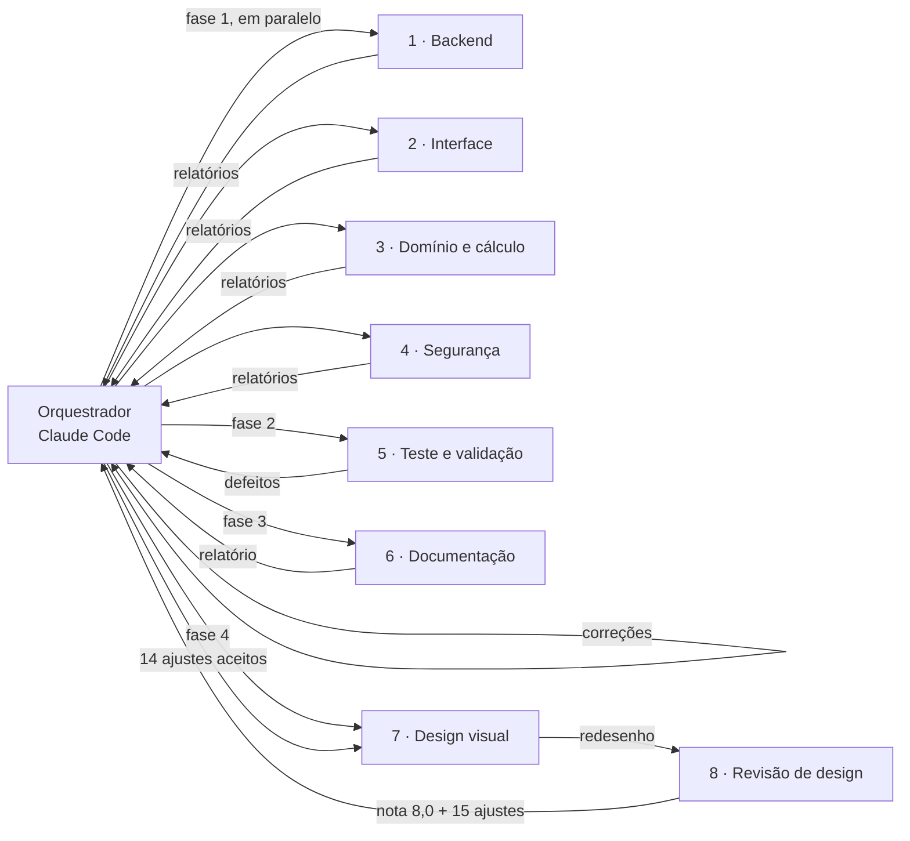

# Engenharia de Agentes e Harness — P26-2B-8356-94BE-3650-165C

## 1. Harness utilizado

- **Harness:** Claude Code (aplicativo desktop Claude, aba Code, Windows 11). Ferramentas: leitura/escrita de arquivos, terminal (PowerShell e Git Bash), navegador embutido (testes visuais e de console) e criação de **subagentes**.
- **Modelo base:** Claude Opus 5.5 (`claude-opus-5-5`) em todos os agentes.
- **Ambiente de execução dos agentes:** Node.js 26 via Scoop (modo usuário), Wrangler 4 (`wrangler pages dev` + D1 local) para testes reais da API.

### Como os agentes foram coordenados
Um **orquestrador** (sessão principal do Claude Code) planejou o trabalho, escreveu as skills e disparou cada especialista como **subagente independente**: processo separado, contexto próprio, com acesso apenas à pasta do projeto e à sua skill. Cada agente recebeu uma **lista fechada de arquivos que podia alterar** — assim agentes rodando em paralelo nunca editaram o mesmo arquivo — e **contratos de interface** fixados antes (ex.: formato de `simular()`, `resumoSemestre()`, `GET /api/conta/exportar`), para que pudessem trabalhar ao mesmo tempo sem esperar uns pelos outros. Os agentes de teste e de segurança **não podiam alterar o código do app**: só reportar, para não "aprovar o próprio trabalho".

| Fase | Agentes | Modo |
|---|---|---|
| 0 (versão inicial) | Orquestrador + Agente de validação inicial | sequencial |
| 1 | Backend, Interface, Domínio, Segurança | **paralelo**, arquivos disjuntos |
| 2 | Teste e Validação | independente, somente leitura do app |
| 3 | Documentação | independente |
| 4 | Design visual → Revisão de design (independente, somente leitura) → Design visual | ciclo de crítica e correção |

---

## 2. Agentes

### Agente 1: Backend Serverless (Pages Functions + D1 + Discord OAuth2)
- **Skills:** [`skills/serverless-d1-discord/SKILL.md`](./skills/serverless-d1-discord/SKILL.md), [`skills/seguranca-web/SKILL.md`](./skills/seguranca-web/SKILL.md)
- **Podia alterar:** `functions/**`, `lib/**`, novas migrações.
- **Entregas:**
  - LGPD: `GET /api/conta/exportar` (download JSON) e `DELETE /api/conta` (exige `{"confirmar":"EXCLUIR"}`, apaga tudo numa transação `batch`).
  - `functions/api/_middleware.js`: `no-store` + `nosniff` em toda resposta da API e **403 para escrita vinda de outra origem** (defesa extra contra CSRF).
  - `functions/api/[[rota]].js`: 404 em JSON para rota inexistente (antes caía no `index.html`).
  - 405 com cabeçalho `Allow` em todas as rotas; `lerJson` recusa >20 000 bytes pelo `Content-Length` (413) e corpo chunked; limite de 40 disciplinas checado **no mesmo INSERT** (sem condição de corrida); `PATCH` de nota filtrado também por `user_id`.
  - `migrations/0002_indice_expiracao_sessoes.sql`: índice para a limpeza de sessões vencidas.
- **Verificação:** >70 checagens com `curl` contra `wrangler pages dev` + D1 local, com 3 usuários de teste (401, 400, 413, 415, IDOR → 404, 405, 403, exportar, excluir conta).

### Agente 2: Interface Web Vanilla (HTML5, CSS3, DOM)
- **Skill:** [`skills/vanilla-dom-ui/SKILL.md`](./skills/vanilla-dom-ui/SKILL.md)
- **Podia alterar:** `public/index.html`, `public/styles.css`, `public/js/app.js`, `public/js/ui/*`.
- **Entregas:**
  - **Visão geral do semestre** (aprovados, em andamento, exame, reprovados, média geral, % avaliado) com seletor de semestre e rotas `#/visao-geral` / `#/disciplina/:id`.
  - **Modo simulação "E se…?"**: notas hipotéticas sem salvar (nenhuma requisição ao servidor), "preencher com a mínima".
  - **Menu da conta** acessível por teclado: baixar dados, sair, excluir conta com confirmação forte.
  - Telas de carregamento/erro com "tentar novamente", primeiros passos com modelo de fórmula, diálogos nativos com foco preso e devolvido, link "pular para o conteúdo", `prefers-reduced-motion`, **boletim para impressão**.
  - Código organizado em módulos: `ui/dom.js`, `api.js`, `dialogos.js`, `conta.js`, `semestre.js`, `situacao.js`.
- **Verificação:** navegador embutido contra servidor local real, em 375/768/1280 px, tema claro e escuro, **0 falhas de contraste AA** (script automático), sem rolagem horizontal, console sem erros.

### Agente 3: Domínio Acadêmico e Motor de Cálculo
- **Skill:** [`skills/dominio-calculo/SKILL.md`](./skills/dominio-calculo/SKILL.md)
- **Podia alterar:** `public/js/calc.js`, `tests/calc.test.mjs`, `tests/index.html`.
- **Entregas:**
  - Funções novas `simular(d, notas)` e `resumoSemestre(disciplinas)`.
  - **6 bugs corrigidos**, entre eles: média exibida "7,00" com situação "exame" (média real 6,9967) — agora médias exibidas são truncadas (`floor2`) e notas mínimas arredondadas para cima (`ceil2`), então o número na tela sempre é coerente com a situação; `round2(1.005)` dando 1; nota "só espaços" contada como zero; peso inválido contaminando as somas.
  - Testes de **14 → 52**, incluindo **testes de propriedade** com 600 disciplinas aleatórias (semente fixa): a nota mínima mostrada sempre basta e 0,01 a menos nunca basta.
- **Verificação:** `node tests/calc.test.mjs` → 52/52. Para provar que os testes detectam erros, introduziu **mutações** de propósito numa cópia (trocar `ceil2`/`floor2` por arredondamento comum): cada mutação derrubou 8 testes.

### Agente 4: Segurança de Aplicações Web
- **Skill:** [`skills/seguranca-web/SKILL.md`](./skills/seguranca-web/SKILL.md)
- **Podia alterar:** só `public/_headers` e `docs/SEGURANCA.md` (auditor, não corrige código alheio).
- **Entregas:**
  - `public/_headers`: **CSP** restritiva (`script-src 'self'`, sem `unsafe-inline`), HSTS, `X-Frame-Options: DENY`, `nosniff`, `Referrer-Policy`, `Permissions-Policy`, COOP.
  - [`docs/SEGURANCA.md`](./docs/SEGURANCA.md): modelo de ameaças, controles com referência a arquivo e linha, achados.
- **Verificação:** CSP validada no navegador embutido (nenhuma violação do app) e **contraprova** — script e estilo inline injetados de propósito foram bloqueados. IDOR e CSRF testados com duas sessões.
- **Achados:** nenhum crítico/alto (sem SQL injection, XSS, IDOR ou CSRF explorável). 9 médios/baixos — corrigidos pelo orquestrador: sessão expira após **7 dias sem uso** (janela deslizante), nome do Discord passa pela limpeza de caracteres de controle/bidi, mensagens públicas de erro sem nomes de variáveis, aviso de privacidade (LGPD) na tela de login, `.gitignore` ampliado.

### Agente 5: Teste e Validação (obrigatório)
- **Skill:** [`skills/teste-validacao/SKILL.md`](./skills/teste-validacao/SKILL.md)
- **Podia alterar:** só `tests/**`. Não corrigia o app — reportava defeitos com passos para reproduzir.
- **Entregas:**
  - [`tests/api.test.mjs`](./tests/api.test.mjs): **suíte de integração automática, sem dependências**, que sozinha cria um D1 local temporário, aplica as migrações, cria 2 usuários e 5 sessões, sobe `wrangler pages dev`, roda os casos e derruba o servidor. Cobre 401/400/413/415, cada regra de validação, **IDOR entre dois alunos**, fluxo completo (resumo do servidor = `calc.js` = conta à mão), 403 de origem cruzada, 404/405, exportação, exclusão de conta e cabeçalhos de segurança; ao final confere no SQLite que não sobrou nenhuma linha órfã.
  - Teste **ponta a ponta** no navegador: do primeiro acesso à exclusão da conta, nota mínima conferida à mão em 4 cenários, simulação sem nenhum `PATCH` enviado, foco de teclado nos diálogos, 375 px e desktop, claro e escuro, sem violações de CSP.
  - [`tests/README.md`](./tests/README.md).
- **Defeitos encontrados (todos corrigidos pelo orquestrador e cobertos por teste quando aplicável):**

| # | Gravidade | Defeito | Correção |
|---|---|---|---|
| 1 | Média | Botão "E se…?" não acompanhava as notas digitadas (simulação vazia ou bloqueada) | Estado do botão atualizado a cada nota; foco seguro ao sair |
| 2 | Baixa | `aria-labelledby` quebrado quando o semestre tem espaço | IDs gerados por índice |
| 3 | Baixa | `HEAD` respondia 405 (monitores veriam o site fora do ar) | `onRequestHead` em toda rota GET + `Allow` com HEAD; **novo caso de teste** |
| 4 | Baixa | Confirmação "EXCLUIR" em minúsculas não dava nenhum aviso | Mensagem de erro clara no diálogo |
| — | Info | Nota −0,001 gravada como −0 | Normalizada para 0 |

### Agente 6: Documentação Técnica
- **Skill:** [`skills/documentacao-tecnica/SKILL.md`](./skills/documentacao-tecnica/SKILL.md)
- **Podia alterar:** `README.md`, `docs/ARQUITETURA.md`.
- **Entregas:** README reestruturado (mantendo o cabeçalho oficial intacto) e [`docs/ARQUITETURA.md`](./docs/ARQUITETURA.md) com diagramas Mermaid de componentes, sequência (login e lançamento de nota) e modelo de dados, tabela de rotas e decisões de projeto. Conferiu cada afirmação lendo o código e rodando as suítes.

### Agente 7: Design Visual e UI
- **Skills:** [`skills/design-visual/SKILL.md`](./skills/design-visual/SKILL.md), [`skills/vanilla-dom-ui/SKILL.md`](./skills/vanilla-dom-ui/SKILL.md)
- **Podia alterar:** `public/styles.css`, `public/index.html`, a parte de apresentação de `public/js/app.js` e `public/js/ui/*`, `public/img/**`, `tests/demo-local.mjs`. Proibido mudar comportamento, cálculo, API ou CSP.
- **Pesquisa de referências** antes de desenhar: calculadoras de nota final (bloco "quanto preciso" em destaque), novo painel do Canvas (cartão por disciplina com nota visível), guias de dashboard (3–7 KPIs, situação com cor + ícone + rótulo), apps de finanças (anéis de progresso, cores de semáforo) e a landing do Linear (título forte + prévia do produto). Padrões adotados, sem copiar marca nem arte de ninguém.
- **Entregas:** identidade visual própria (índigo + cores semânticas fixas, fonte do sistema com números tabulares, tokens de espaço/raio/sombra), shell com barra lateral fixa, landing de login com prévia do painel em HTML/CSS, KPIs com anéis `conic-gradient`, selos de situação, régua "Onde sua média pode terminar" com zonas de reprovação/exame/aprovação, tabela de notas refinada, ilustrações SVG próprias, menu "⋯" no celular. `tests/demo-local.mjs`: sobe o app local com um aluno e 9 disciplinas cobrindo todas as situações.
- **Verificação:** 8 combinações (375/768/1280/1440 px × claro/escuro) × 17–19 estados: **0 falhas de contraste AA**, 0 rolagem horizontal, 0 erros de JavaScript, **0 violações de CSP**, simulação sem nenhum `PATCH`; suítes 52/52 e 30/30 mantidas.

### Agente 8: Revisão de Design e UX (independente)
- **Skill:** [`skills/design-visual/SKILL.md`](./skills/design-visual/SKILL.md) (como critério de avaliação)
- **Podia alterar:** nada (somente leitura). Subiu o demo, tirou capturas de tela de todas as telas em 4 larguras e 2 temas e comparou com produtos do gênero.
- **Resultado:** nota **8,0/10** ("já parece um produto real"), 3 pontos fortes a preservar e 15 problemas priorizados com correção sugerida. Os mais importantes: barra lateral escondida sob o topo no fim da rolagem, cor de "Listas" igual à de alerta, nota do exame aparecendo depois do "Inalcançável", informação principal abaixo da dobra no celular.
- **Decisão do orquestrador:** 14 itens aceitos e devolvidos ao Agente 7, que os corrigiu e verificou de novo. O item 15 (desabilitar o botão de excluir conta até digitar EXCLUIR) foi **recusado** porque contradiz um defeito confirmado pelo Agente 5 (desabilitado, o Enter com a palavra errada não dava aviso nenhum).

### Fase 0: versão inicial e primeira validação
Antes das fases acima, o orquestrador construiu a primeira versão do sistema e um **agente de validação inicial** (subagente somente leitura) a auditou: nenhum problema crítico; 8 achados (`.gitignore` ausente, arredondamento antes da validação, cookie malformado gerando 500, edição de fórmula sobrescrevendo notas, entre outros), todos corrigidos naquela rodada.

---

## 3. Resultado consolidado

| Verificação | Resultado |
|---|---|
| `node tests/calc.test.mjs` | **52/52** |
| `node tests/api.test.mjs` (servidor + D1 locais reais) | **30/30** |
| `node validar-local.mjs P26-2B-8356-94BE-3650-165C` | 9/9 itens |
| Falhas críticas/altas de segurança | **0** |
| Contraste AA / violações de CSP (8 combinações de tela e tema) | **0 / 0** |
| Nota da revisão de design independente | **8,0/10**, com 14 ajustes aplicados |

## 4. Skills (pasta `skills/`)

| Skill | Usada por |
|---|---|
| `serverless-d1-discord` | Agente 1 |
| `vanilla-dom-ui` | Agente 2 |
| `dominio-calculo` | Agente 3 |
| `seguranca-web` | Agentes 1 e 4 |
| `teste-validacao` | Agente 5 e agente de validação inicial |
| `documentacao-tecnica` | Agente 6 |
| `design-visual` | Agentes 7 e 8 |
