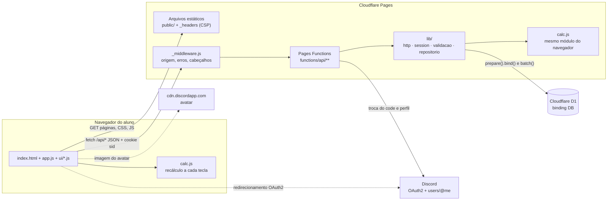
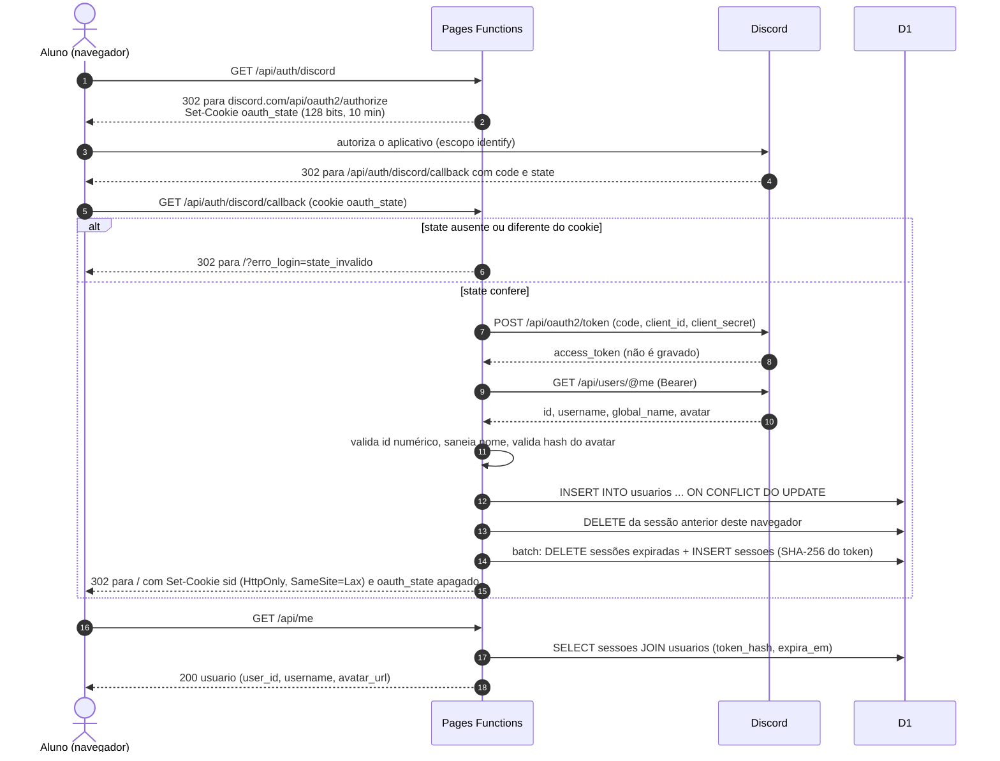
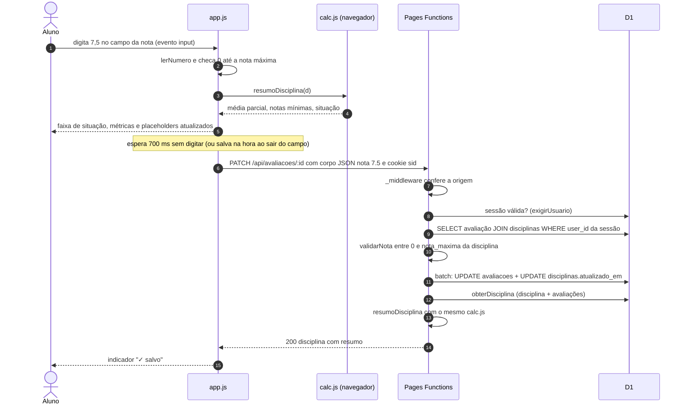
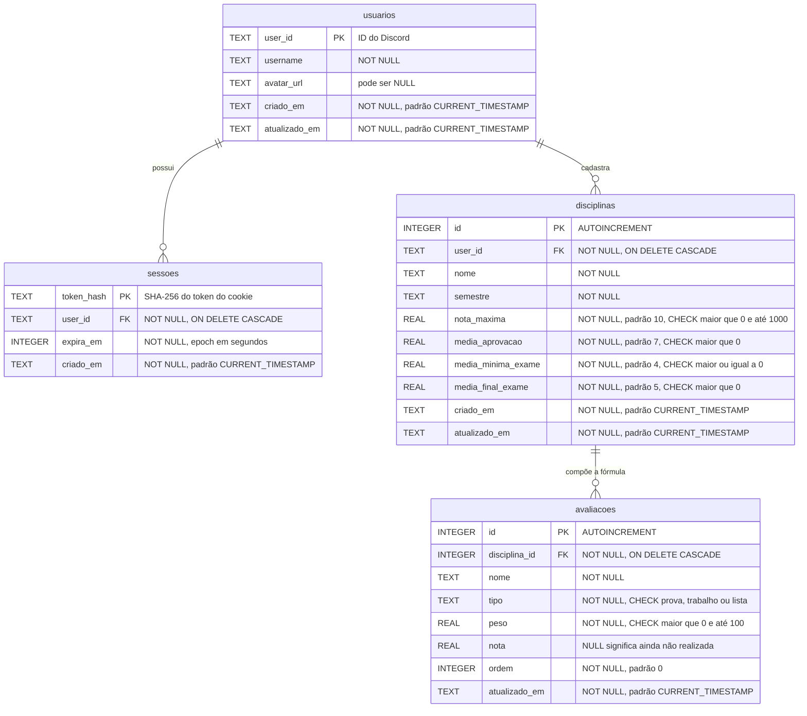

# Arquitetura — Simulador de Médias (P26-2B-8356-94BE-3650-165C)

Documento técnico do Projeto #17, "Calculadora e Simulador de Desempenho Acadêmico". Tudo o que está aqui foi conferido no código desta pasta (`functions/`, `lib/`, `migrations/`, `public/`, `wrangler.jsonc`) e nas suítes de `tests/`. Visão do produto e instruções de uso: [README](../README.md). Segurança: [SEGURANCA.md](./SEGURANCA.md).

**Sumário:** [1. Visão geral](#1-visão-geral) · [2. Componentes](#2-componentes) · [3. Fluxos](#3-fluxos) · [4. Modelo de dados](#4-modelo-de-dados) · [5. API](#5-api) · [6. Sessão](#6-sessão) · [7. Frontend](#7-frontend) · [8. Decisões de projeto](#8-decisões-de-projeto) · [9. Limitações conhecidas](#9-limitações-conhecidas)

---

## 1. Visão geral

| Item | Escolha |
| --- | --- |
| Hospedagem | Cloudflare Pages, projeto `p26-2b-8356-94be-3650-165c`, publicado por upload direto (`wrangler pages deploy`) |
| Frontend | `public/`: HTML5, CSS3 e JavaScript puro em módulos ES; sem framework, sem build |
| Backend | Cloudflare Pages Functions em `functions/api/` (roteamento por arquivos) |
| Banco | Cloudflare D1 (SQLite) `db-p26-2b-8356-94be-3650-165c`, *binding* `DB`, migrações em `migrations/` |
| Identidade | Discord OAuth2, *authorization code*, escopo `identify` |
| Regra de cálculo | `public/js/calc.js`, módulo puro importado pelo navegador **e** pelas Functions |
| Configuração | `wrangler.jsonc` (`pages_build_output_dir: ./public`, `compatibility_date: 2026-03-01`); segredos `DISCORD_CLIENT_ID` e `DISCORD_CLIENT_SECRET` |

O cálculo acontece no cliente, a cada tecla. O servidor é a fonte da verdade para **o que é gravado**: valida todas as regras, filtra tudo pelo usuário da sessão e devolve o resumo calculado pelo mesmo `calc.js`.

## 2. Componentes



| Camada | Arquivos | Responsabilidade |
| --- | --- | --- |
| Página | `public/index.html`, `styles.css`, `_headers` | Telas (carregando, erro, login, app), diálogos `<dialog>`, rodapé com a Chave Única, tema claro/escuro, impressão, cabeçalhos de segurança |
| Interface | `public/js/app.js` | Estado, rotas por *hash*, tabela de notas, simulação, editor da fórmula, salvamento automático |
| Módulos de UI | `public/js/ui/` | `api.js` (fetch + 401), `dom.js` (DOM sem `innerHTML`), `dialogos.js` (confirmação), `conta.js` (menu da conta, LGPD), `semestre.js` (visão geral e primeiros passos), `situacao.js` (rótulos e cores) |
| Domínio | `public/js/calc.js` | `resumoDisciplina`, `notaNecessaria`, `situacao`, `simular`, `resumoSemestre`, arredondamentos `ceil2`/`floor2`/`round2` |
| Borda da API | `functions/api/_middleware.js`, `[[rota]].js` | 403 para escrita de outra origem, 500 em JSON, `Cache-Control: no-store` e `nosniff` em toda resposta, `HEAD` sem corpo; 404 JSON para rota inexistente |
| Rotas | `functions/api/**` | Um arquivo por recurso; handlers por método (`onRequestGet`, `onRequestPost`…) e `onRequest = metodoNaoPermitido(...)` para os demais |
| Infra HTTP | `lib/http.js` | `json`, `erro`, `HttpError`, `lerJson` (tipo, tamanho, UTF-8), `exigirObjeto`, `metodoNaoPermitido` (405/`OPTIONS`), `rota` (503 sem D1, conversão de erros) |
| Sessão | `lib/session.js` | Cookies, token aleatório, SHA-256, criar/ler/renovar/encerrar sessão, `exigirUsuario` (401) |
| Regras | `lib/validacao.js` | Validação e normalização de disciplina, nota, id e confirmação de exclusão; limites de 40 disciplinas e 30 avaliações |
| Dados | `lib/repositorio.js` | Todo o SQL; sempre filtrando por `user_id`; monta disciplinas com `avaliacoes` e `resumo` |

## 3. Fluxos

### 3.1 Login com Discord



Saídas de erro do callback (sempre `302` para `/?erro_login=<motivo>`, com o cookie `oauth_state` apagado): código de erro do próprio Discord (ex.: `access_denied`, aceito só no formato `^[a-z_]{1,40}$`), `state_invalido`, `servidor_nao_configurado`, `troca_de_token_falhou`, `perfil_discord_falhou`, `perfil_invalido` e `erro_inesperado`. A interface mostra a mensagem correspondente na tela de login.

### 3.2 Lançamento de nota com recálculo



Avaliação de outro aluno ou inexistente → `404`; nota fora da faixa, texto, booleano ou sem o campo `nota` → `400`. Se a resposta trouxer uma nota diferente da enviada e o aluno não tiver digitado nada depois, a interface adota a do servidor.

### 3.3 Edição da fórmula e exclusão da conta

- `PUT /api/disciplinas/:id` recebe a disciplina inteira. Avaliações com `id` são atualizadas (nome, tipo, peso, ordem) **sem tocar na nota**; sem `id` são inseridas; as que não vierem são apagadas. Tudo em um único `batch` do D1, que é transacional.
- `DELETE /api/conta` com `{"confirmar":"EXCLUIR"}` apaga, em um único `batch`, avaliações → disciplinas → sessões → usuário, e devolve o cookie `sid` expirado.

## 4. Modelo de dados

Esquema de `migrations/0001_init.sql` + `migrations/0002_indice_expiracao_sessoes.sql`:



**Restrições de tabela** em `disciplinas`: `CHECK (media_minima_exame <= media_aprovacao)` e `CHECK (media_aprovacao <= nota_maxima)`.

**Índices**

| Índice | Tabela (colunas) | Migração | Uso |
| --- | --- | --- | --- |
| `idx_sessoes_user` | `sessoes (user_id)` | 0001 | Apagar todas as sessões do aluno na exclusão da conta |
| `idx_disciplinas_user` | `disciplinas (user_id, semestre)` | 0001 | Listar a grade do aluno e contar o limite de 40 |
| `idx_avaliacoes_disciplina` | `avaliacoes (disciplina_id, ordem)` | 0001 | Buscar avaliações na ordem da fórmula |
| `idx_sessoes_expira` | `sessoes (expira_em)` | 0002 | `DELETE FROM sessoes WHERE expira_em < ?`, executado a cada login |

**Divisão de responsabilidades entre banco e aplicação.** O banco garante chaves, tipos de avaliação e faixas principais. A aplicação (`lib/validacao.js`) garante também o que o esquema não expressa: `media_final_exame ≤ nota_maxima`, nota entre 0 e a nota máxima da disciplina, tamanho dos textos, 1 a 30 avaliações por disciplina e 40 disciplinas por aluno. A nota é `REAL` com no máximo 2 casas (arredondada pela validação).

## 5. API

### 5.1 Convenções

- **Formato:** JSON UTF-8. Sucesso: `{"ok": true, ...}`. Erro: `{"ok": false, "erro": "mensagem em português"}`.
- **Corpo de escrita:** exige `Content-Type: application/json` (senão **415**), no máximo 20 000 bytes, checado pelo `Content-Length` e também durante a leitura em fluxo (**413**), UTF-8 válido, não vazio e JSON válido (**400**).
- **Autenticação:** cookie `sid`. Rotas marcadas "sessão" respondem **401** `"Faça login com o Discord."` sem sessão válida.
- **Isolamento:** toda consulta filtra pelo `user_id` da sessão; disciplina ou avaliação de outro aluno responde **404**, igual a um id inexistente.
- **Ids** de rota: inteiro positivo (`^[1-9]\d{0,15}$`); outro formato → **400**.
- **Middleware (toda `/api/*`):** métodos diferentes de `GET`/`HEAD`/`OPTIONS` com `Sec-Fetch-Site: cross-site` ou `Origin` diferente da origem do site → **403**; exceção não tratada → **500** em JSON; acrescenta `Cache-Control: no-store` e `X-Content-Type-Options: nosniff` a toda resposta.
- **Métodos:** cada rota com `GET` também aceita `HEAD` (mesma resposta, sem corpo). Método não suportado → **405** em JSON com cabeçalho `Allow`. `OPTIONS` → **204** com `Allow` (não há CORS: a API é só de mesma origem).
- **Sem banco:** rotas que usam o D1 respondem **503** se o *binding* `DB` não existir.
- **Rota inexistente** em `/api/*`, com qualquer método → **404** em JSON (`functions/api/[[rota]].js`), nunca o `index.html`.

### 5.2 Rotas

| Método | Caminho | Acesso | Corpo | Respostas |
| --- | --- | --- | --- | --- |
| `GET` `HEAD` | `/api/status` | público | — | **200** `{ok, chave, projeto, d1Conectado, discordConfigurado, horario}` |
| `GET` `HEAD` | `/api/me` | público | — | **200** `{ok, loginDisponivel, usuario}`; `usuario` é `{user_id, username, avatar_url}` ou `null`; nenhum dado acadêmico · **503** sem D1 |
| `GET` `HEAD` | `/api/auth/discord` | público | — | **302** para o Discord com cookie `oauth_state` · **503** JSON se o Discord não estiver configurado |
| `GET` | `/api/auth/discord/callback` | público (cookie `oauth_state`) | *query* `code`, `state` | **302** para `/` com cookie `sid` · **302** para `/?erro_login=<motivo>` (seção 3.1) |
| `HEAD` | `/api/auth/discord/callback` | público | — | **204** sem efeito (o `code` só pode ser trocado uma vez) |
| `POST` | `/api/auth/logout` | sem exigência | — | **200** `{ok:true}`, apaga a sessão no D1 e expira o cookie `sid` |
| `GET` `HEAD` | `/api/disciplinas` | sessão | — | **200** `{ok, disciplinas:[...]}`, cada uma com `avaliacoes` e `resumo` |
| `POST` | `/api/disciplinas` | sessão | disciplina (abaixo); `id` das avaliações é ignorado | **201** `{ok, disciplina}` · **400** validação · **409** limite de 40 · **413** · **415** |
| `GET` `HEAD` | `/api/disciplinas/:id` | sessão | — | **200** `{ok, disciplina}` · **400** id · **404** |
| `PUT` | `/api/disciplinas/:id` | sessão | disciplina completa; avaliações com `id` são mantidas | **200** `{ok, disciplina}` · **400** validação, avaliação de outra disciplina, id repetido ou nota já lançada acima da nova nota máxima · **404** |
| `DELETE` | `/api/disciplinas/:id` | sessão | — | **200** `{ok:true}` · **404** |
| `PATCH` | `/api/avaliacoes/:id` | sessão | `{"nota": número \| null}` (`null` limpa) | **200** `{ok, disciplina}` com o resumo recalculado · **400** · **404** |
| `GET` `HEAD` | `/api/conta/exportar` | sessão | — | **200** arquivo `meus-dados-<user_id>.json` (`Content-Disposition: attachment`) com `{exportado_em, usuario:{user_id, username, avatar_url, criado_em}, disciplinas}` |
| `DELETE` | `/api/conta` | sessão | `{"confirmar": "EXCLUIR"}` exatamente | **200** `{ok:true}` e cookie expirado · **400** com qualquer outro corpo (nada é apagado) · **413** |
| qualquer | `/api/*` não listada | — | — | **404** `{ok:false, erro}` |

Todas as rotas de sessão respondem **401** sem login e todas as de escrita respondem **403** a pedidos de outra origem. Valores do cabeçalho `Allow` no **405**: `GET, HEAD, OPTIONS` (status, me, auth/discord, auth/discord/callback, conta/exportar); `POST, OPTIONS` (logout); `GET, HEAD, POST, OPTIONS` (disciplinas); `GET, HEAD, PUT, DELETE, OPTIONS` (disciplinas/:id); `PATCH, OPTIONS` (avaliacoes/:id); `DELETE, OPTIONS` (conta).

**Corpo de disciplina** (`POST` e `PUT`):

```json
{
  "nome": "Cálculo II",
  "semestre": "2026.2",
  "nota_maxima": 10,
  "media_aprovacao": 7,
  "media_minima_exame": 4,
  "media_final_exame": 5,
  "avaliacoes": [
    { "id": 12, "nome": "Prova 1", "tipo": "prova", "peso": 35, "nota": 6 },
    { "nome": "Lista 1", "tipo": "lista", "peso": 10, "nota": null }
  ]
}
```

Regras: `nome` 2–80 caracteres, `semestre` 4–20, nome da avaliação 1–60 (controle e bidi removidos, espaços normalizados); `0 < nota_maxima ≤ 1000` (padrão 10); `0 < media_aprovacao ≤ nota_maxima` (padrão 7); `0 ≤ media_minima_exame ≤ media_aprovacao` (padrão 4); `0 < media_final_exame ≤ nota_maxima` (padrão 5); 1 a 30 avaliações; `tipo` ∈ {`prova`, `trabalho`, `lista`}; `0 < peso ≤ 100`; `nota` `null` ou entre 0 e `nota_maxima`. Números podem vir como número ou texto decimal (vírgula aceita), e são arredondados a 2 casas antes da checagem de faixa; `""`, `"0x10"` e `"1e3"` são recusados.

**Resumo** devolvido em cada disciplina (`resumo`, gerado por `resumoDisciplina`): `pesoTotal`, `pesoAvaliado`, `percentualAvaliado`, `restantes`, `mediaParcial`, `pontosGarantidos`, `mediaMaxima`, `mediaFinal`, `aprovacao` e `evitarReprovacao` (`{status: "garantido" | "possivel" | "impossivel", nota}`), `exame` (ou `null`), `situacao` (`sem_formula`, `aprovado`, `em_andamento`, `exame_inevitavel`, `exame`, `reprovado`) e `porTipo` (para provas, trabalhos e listas: peso, quantidade, média e percentual da média final).

## 6. Sessão

| Aspecto | Implementação (`lib/session.js`) |
| --- | --- |
| Token | 32 bytes de `crypto.getRandomValues` (256 bits), em hexadecimal no cookie `sid` |
| Armazenamento | Só `SHA-256(token)` em `sessoes.token_hash` |
| Cookie | `Path=/; HttpOnly; SameSite=Lax; Max-Age=2592000` (30 dias) e `Secure` quando a requisição é HTTPS |
| Expiração no servidor | `expira_em` = agora + 7 dias; a cada uso, se faltar menos de 6 dias, é renovada para + 7 dias (no máximo uma escrita por dia) |
| Validação | Token precisa casar com `^[0-9a-f]{64}$` antes de ir ao banco; cookie malformado conta como "sem sessão", nunca 500 |
| Encerramento | Logout e novo login apagam a linha da sessão; exclusão da conta apaga todas as sessões do aluno |
| Limpeza | Sessões vencidas são apagadas a cada login (`idx_sessoes_expira`) |
| OAuth `state` | 16 bytes (128 bits) no cookie `oauth_state`, `Max-Age=600`, apagado em todas as saídas do callback |

## 7. Frontend

- **Telas:** carregando → `GET /api/me` → login ou aplicação. Sem sessão, a tela de login traduz `?erro_login=` em mensagem e remove o parâmetro da URL.
- **Rotas por *hash*:** `#/visao-geral` (painel do semestre, ou "Primeiros passos" com a grade vazia) e `#/disciplina/:id`. Id desconhecido volta para a visão geral; trocar de disciplina descarta a simulação.
- **Estado:** um objeto `estado` em `app.js` (`usuario`, `disciplinas`, `selecionadaId`, `semestreVisao`, `simulacao`, `pendentes`). Cada disciplina guarda o `resumo` recalculado localmente.
- **Cálculo e salvamento:** o evento `input` valida a nota, chama `resumoDisciplina` e atualiza faixa, métricas, metas, *placeholders* e a lista lateral. O envio (`PATCH`) é agendado para 700 ms depois da última tecla, ou feito na hora no `blur`. "Sair" envia as notas pendentes antes do logout; `beforeunload` avisa se ainda houver nota pendente. Um 401 em qualquer chamada leva de volta à tela de login.
- **Simulação "E se…?":** `estado.simulacao.notas` guarda notas hipotéticas por id de avaliação; o resumo vem de `simular(d, notas)`, que não altera a disciplina. Nada é enviado à API.
- **Visão geral:** `resumoSemestre` recalcula cada disciplina (não confia no `resumo` recebido) e normaliza as médias para 0–10 antes de calcular a média geral.
- **DOM seguro:** todo conteúdo entra por `el()`/`textContent` (`ui/dom.js`); não há `innerHTML`, `eval` nem `<script>` ou `style=""` inline, o que permite a CSP sem `'unsafe-inline'`. Estilos dinâmicos (larguras das barras) usam CSSOM.
- **Acessibilidade:** link "Pular para o conteúdo", foco gerenciado nos `<dialog>`, região `aria-live` que anuncia a situação depois de 700 ms sem digitação, menu da conta operável por teclado (setas, Home/End, Esc).
- **Impressão:** `@media print` em `styles.css` e um cabeçalho "Boletim da disciplina" visível só no papel, com data/hora atualizada no evento `beforeprint`.

## 8. Decisões de projeto

**ADR-1 — Um único módulo de cálculo para cliente e servidor.**
*Contexto:* o enunciado pede cálculo instantâneo no cliente, mas o servidor também precisa devolver médias confiáveis. *Decisão:* `public/js/calc.js` é um módulo ES puro, sem DOM e sem estado; o navegador o importa de `/js/calc.js` e as Functions o importam de `../public/js/calc.js` (`lib/repositorio.js`, `lib/validacao.js`). *Consequência:* não existe uma segunda implementação para divergir; `api.test.mjs` confere que o `resumo` do servidor é igual ao de `calc.js` e à conta feita à mão.

**ADR-2 — Sessão opaca no D1, guardando só o hash.**
*Contexto:* era preciso logout real e exclusão de conta que derrube todas as sessões. *Decisão:* token aleatório de 256 bits no cookie `HttpOnly` e `SHA-256` dele na tabela `sessoes`, em vez de um token assinado (JWT) sem estado. *Consequência:* revogação imediata (`DELETE` de uma linha); uma cópia vazada da tabela não permite sequestrar sessões. Custo: uma consulta ao D1 por requisição autenticada, com renovação limitada a uma escrita por dia.

**ADR-3 — Sem framework e sem etapa de build.**
*Contexto:* a rubrica exige HTML5, CSS3 e JavaScript puro. *Decisão:* módulos ES nativos servidos diretamente de `public/`; utilitário próprio `el()` para montar o DOM. *Consequência:* o código publicado é o código revisado, não há dependências de npm no projeto, e a CSP pode proibir scripts e estilos inline.

**ADR-4 — Notas só mudam pelo `PATCH`; o `PUT` da fórmula preserva as notas.**
*Contexto:* o aluno pode ter duas abas abertas; editar a fórmula em uma aba antiga não pode apagar uma nota lançada depois na outra. *Decisão:* `PATCH /api/avaliacoes/:id` grava uma nota por vez; `PUT /api/disciplinas/:id` ignora o campo `nota` das avaliações que já existem e só o usa para checar a nova nota máxima. *Consequência:* salvamento fino a cada nota e sem perda de dados entre abas.

**ADR-5 — 404 para recurso de outro aluno.**
*Decisão:* toda consulta inclui `user_id = ?` da sessão, e a ausência de linha resulta em 404, igual a um id inexistente. *Consequência:* não há como descobrir quais ids existem; `salvarNota` repete o filtro por dono como defesa em profundidade.

**ADR-6 — Arredondamento conservador.**
*Decisão:* notas mínimas sobem (`ceil2`), médias exibidas descem (`floor2`) e a classificação usa o valor exato com tolerância `1e-9` só para ponto flutuante. *Consequência:* "tirar exatamente a nota mostrada basta" e "0,01 a menos não basta" valem sempre, o que é verificado por testes de propriedade sobre 600 disciplinas aleatórias.

**ADR-7 — Invariantes com concorrência resolvidos no SQL.**
*Decisão:* o limite de 40 disciplinas é aplicado na própria instrução (`INSERT ... SELECT ... WHERE (SELECT COUNT(*) ...) < 40 RETURNING id`); atualizações de fórmula, nota e exclusões usam `DB.batch`, que é transacional. A exclusão da conta apaga cada tabela explicitamente (filha → pai) em vez de depender só do `ON DELETE CASCADE`. *Consequência:* duas abas criando disciplinas ao mesmo tempo não furam o limite, e não sobram linhas órfãs (conferido no banco pela suíte de API).

**ADR-8 — Publicação por upload direto com o Wrangler.**
*Contexto:* o repositório da turma (fork de `frankalcantara/Avalia2026-2`) guarda cada projeto numa subpasta. *Decisão:* `npx.cmd wrangler pages deploy --branch main` a partir desta pasta, com `pages_build_output_dir` e o *binding* do D1 declarados em `wrangler.jsonc`, em vez da integração Git do Pages. *Consequência:* o que vai ao ar é exatamente `public/` + `functions/` desta pasta; cada atualização exige repetir o `pages deploy`.

## 9. Limitações conhecidas

- **Criação de disciplina em dois passos:** a disciplina é inserida (com o limite checado) e depois as avaliações, em um `batch`. Se o segundo passo falhar, o código apaga a disciplina criada (compensação), mas os dois passos não formam uma única transação.
- **Sem limitação de taxa** nas rotas de escrita e no início do login (recomendação registrada em `SEGURANCA.md`).
- **Limpeza de sessões vencidas** só acontece quando alguém faz login; sessões expiradas não são aceitas, mas ficam na tabela até lá.
- **`/api/status` é público** e informa se o D1 e o Discord estão configurados (útil para a avaliação; em produção real seria restrito).
- **Situação "em andamento"** supõe a mesma nota em todas as avaliações restantes; a simulação "E se…?" cobre cenários com notas diferentes.
